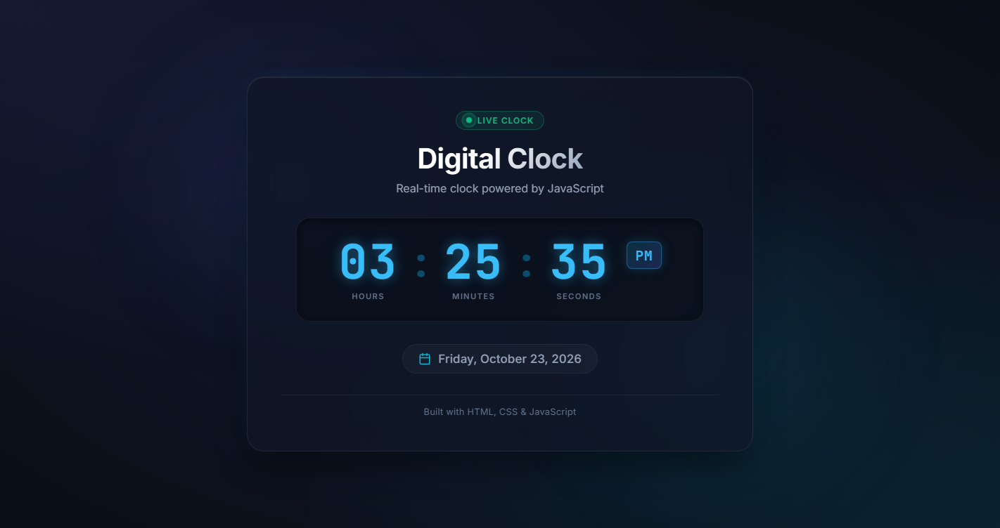
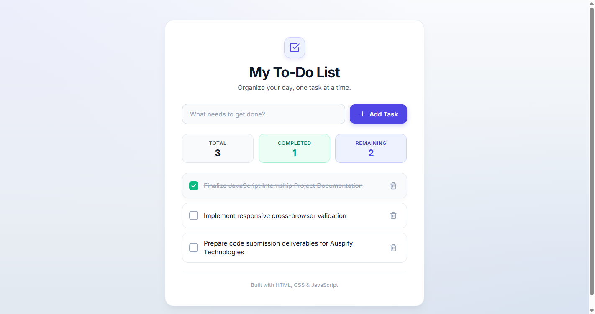
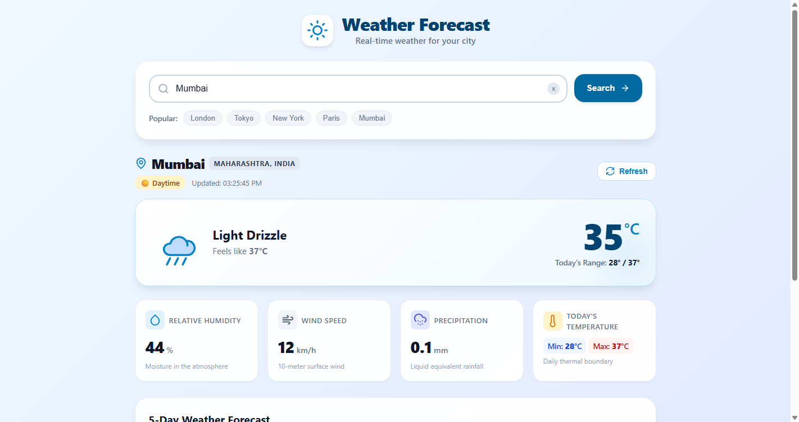
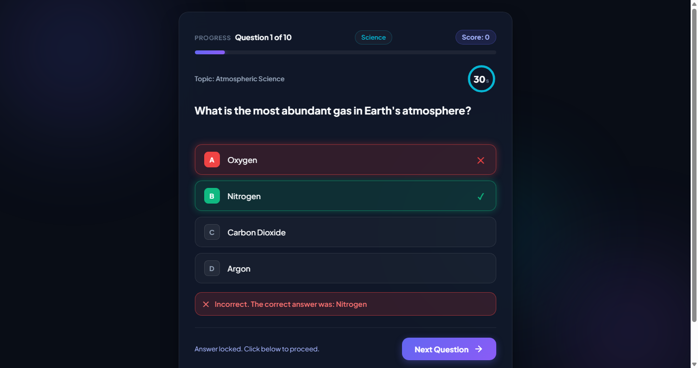
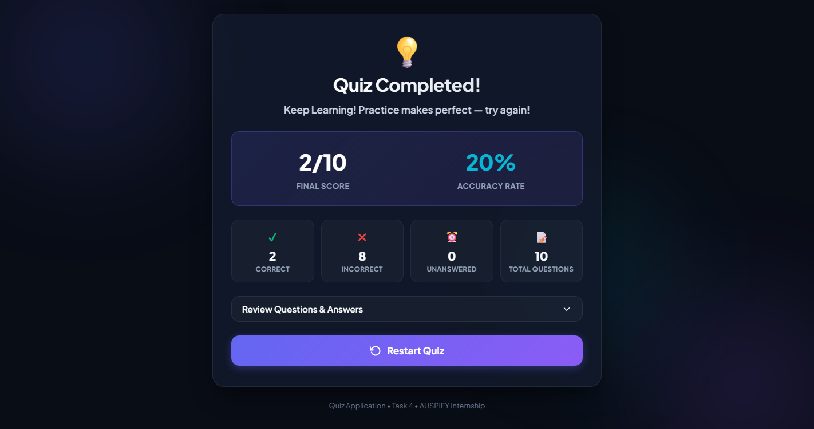
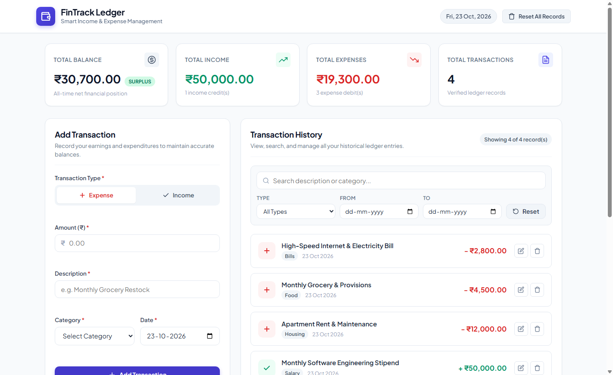
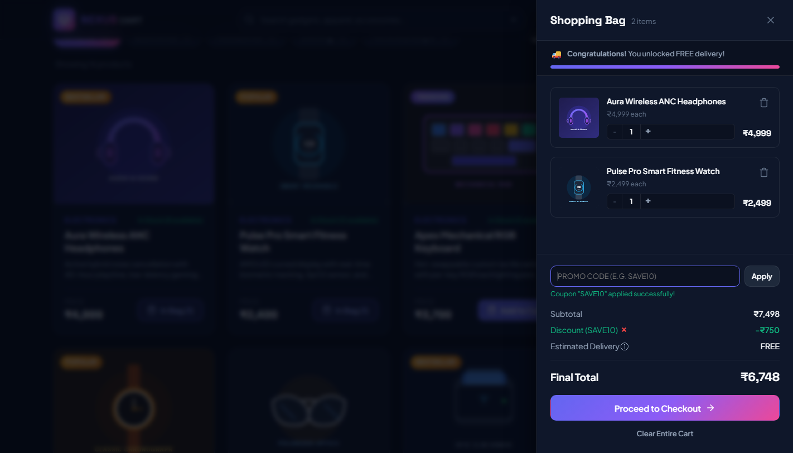
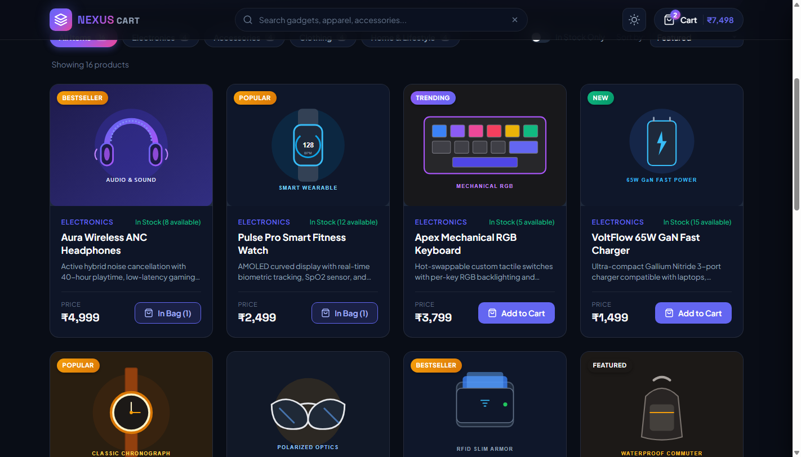

# Auspify Technologies — JavaScript Internship Submission

---

## Intern Information

- **Intern Name**: **MEET KALPESHBHAI SHETH**
- **Intern ID**: **AT/INT/2041569**
- **Company**: **Auspify Technologies**
- **Track**: **JavaScript / Frontend Web Development**
- **Repository Location**: `M:\Mit\INTERNSHIP\MEET SHETH`

---

## Executive Summary

This repository contains the complete, production-grade submissions for all six tasks assigned during the **Auspify Technologies Web Development Internship**. Each project is built using semantic **HTML5**, responsive **Vanilla CSS3**, modern **Vanilla JavaScript (ES6+)**, and native browser web APIs with **zero external framework dependencies**.

All applications have been thoroughly tested and verified across modern browsers, adhering to strict coding standards, responsive design principles, accessible semantics (ARIA), and data persistence where applicable.

---

## Repository Structure

```text
M:\Mit\INTERNSHIP\MEET SHETH\
├── TASK 1/                          # Task 1: Digital Clock
│   ├── index.html                   # Root redirect / launcher
│   └── digital-clock/
│       ├── index.html               # Main clock markup
│       ├── style.css                # Glassmorphic layout, glowing neon theme
│       ├── script.js                # Real-time Date API logic & interval updates
│       └── README.md                # Task-specific documentation
│
├── TASK 2/                          # Task 2: To-Do List Application
│   └── todo-list/
│       ├── index.html               # Semantic task list markup
│       ├── style.css                # Clean productivity styling & responsive grid
│       ├── script.js                # Task model, DOM manipulation & localStorage
│       └── README.md                # Task-specific documentation
│
├── TASK 3/                          # Task 3: Weather Forecast Application
│   ├── index.html                   # Root redirect / launcher
│   ├── README.md                    # Root task documentation
│   └── weather-forecast/
│       ├── index.html               # Weather dashboard markup & SVG icons
│       ├── style.css                # Atmospheric theme, card grids & animations
│       ├── script.js                # Open-Meteo REST API client & 5-day forecast
│       └── README.md                # Task-specific documentation
│
├── TASK 4/                          # Task 4: Interactive Quiz Application
│   ├── index.html                   # Root redirect / launcher
│   ├── README.md                    # Root task documentation
│   └── quiz-app/
│       ├── index.html               # Quiz screens (Start, Quiz, Results)
│       ├── style.css                # Dark modern gaming theme & progress gauges
│       ├── script.js                # Timer engine, question bank & score tracker
│       └── README.md                # Task-specific documentation
│
├── TASK 5/                          # Task 5: Expense Tracker (FinTrack Ledger)
│   ├── index.html                   # Financial dashboard & transaction ledger
│   ├── style.css                    # FinTech design system & proportional bars
│   ├── script.js                    # State management, validation & integer paise math
│   ├── test_suite.js                # Automated testing suite
│   └── README.md                # Task-specific documentation
│
├── TASK 6/                          # Task 6: E-Commerce Shopping Cart (Nexus Cart)
│   ├── assets/products/             # 16 Custom SVG product illustrations
│   ├── index.html                   # E-commerce store, product grid & checkout
│   ├── style.css                    # Premium dark store theme, drawer & badges
│   ├── script.js                    # Cart state, coupons, tax/shipping & filtering
│   ├── server.js                    # Lightweight local Node.js static server
│   ├── test_suite.js                # Automated verification suite
│   └── README.md                # Task-specific documentation
│
├── screenshots/                     # Verified application state captures
│   ├── task-1-digital-clock.png     # Live digital clock state
│   ├── task-2-todo-list.png         # Populated task list with completed item
│   ├── task-3-weather-forecast.png  # Live Open-Meteo weather report for Mumbai
│   ├── task-4-quiz-app.png          # Active question screen with timer & feedback
│   ├── task-4-quiz-results.png      # Final score and performance breakdown
│   ├── task-5-expense-tracker.png   # Balance, income, expenses & ledger history
│   ├── task-6-shopping-cart.png     # Cart drawer with items, coupon & totals
│   └── task-6-product-catalog.png   # Full product grid with cart indicators
│
└── README.md                        # Master internship submission documentation
```

---

## Tasks Overview & Implemented Features

### 1. Task 1 — Digital Clock
- **Location**: `TASK 1/digital-clock/`
- **Entry Point**: `TASK 1/digital-clock/index.html` *(or root redirect `TASK 1/index.html`)*
- **Key Features**:
  - Live local time using the native JavaScript `Date` API (`new Date()`).
  - Seamless 1-second interval refresh (`setInterval`) initialized immediately upon page load to eliminate display delay.
  - Consistent 12-hour formatting with AM/PM indicator and two-digit zero-padding (`padStart(2, '0')`).
  - Full localized calendar date formatted with weekday name (e.g., `Friday, October 23, 2026`).
  - Monospaced numeric typography (`font-variant-numeric: tabular-nums;`) to prevent digit-switching jitter.
  - Modern dark glassmorphic card design with subtle neon glows and pulsing live status badge.

### 2. Task 2 — To-Do List Application
- **Location**: `TASK 2/todo-list/`
- **Entry Point**: `TASK 2/todo-list/index.html`
- **Key Features**:
  - Add tasks dynamically using either the **Add Task** button or the **Enter** key.
  - Mark tasks as completed or active with custom styled checkboxes and accessible states.
  - Delete individual tasks safely using event delegation.
  - Persistent data storage via browser `localStorage`, ensuring tasks survive page reloads and browser restarts.
  - Real-time statistics counters updating dynamically: **Total**, **Completed**, and **Remaining** tasks.
  - Accessible empty state graphic when all tasks are cleared or completed.

### 3. Task 3 — Weather Forecast Application
- **Location**: `TASK 3/weather-forecast/`
- **Entry Point**: `TASK 3/weather-forecast/index.html` *(or root redirect `TASK 3/index.html`)*
- **Key Features**:
  - Global city search with coordinate resolution via the **Open-Meteo Geocoding API**.
  - Current meteorological conditions via the **Open-Meteo Weather Forecast API** (zero API key required).
  - Temperature in Celsius (°C), apparent "feels-like" temperature, and WMO condition interpretation.
  - Detailed environmental cards: Relative Humidity (%), Wind Speed (km/h), Precipitation (mm), and Daily Min/Max thermal range.
  - 5-Day daily weather forecast cards with projected high/low temperatures and conditions.
  - Day / Night adaptive badges and self-contained inline SVG weather icons.
  - Quick-search chips for popular cities (Mumbai, London, Tokyo, New York, Paris).
  - Robust error handling for empty queries, unknown locations, network errors, and request race conditions.

### 4. Task 4 — Interactive Quiz Application
- **Location**: `TASK 4/quiz-app/`
- **Entry Point**: `TASK 4/quiz-app/index.html` *(or root redirect `TASK 4/index.html`)*
- **Key Features**:
  - 10 structured multiple-choice questions across Science, Technology, and General Knowledge.
  - Real-time circular countdown timer (30 seconds per question) with animated SVG dash-offset and low-time warning indicator.
  - Single-selection answer locking with immediate validation feedback (emerald correct glow, crimson incorrect highlight, and correct answer reveal).
  - Automatic advance on timeout recording unanswered questions as 0 points.
  - Dynamic score pill and linear progress gauge tracking completion percentage.
  - Post-quiz results dashboard displaying final score (`X/10`), accuracy percentage, metric breakdown cards (Correct, Incorrect, Unanswered), and an expandable question-by-question review accordion.
  - Non-destructive "Restart Quiz" button re-initializing state without page reload.

### 5. Task 5 — Expense Tracker (FinTrack Ledger)
- **Location**: `TASK 5/`
- **Entry Point**: `TASK 5/index.html`
- **Key Features**:
  - Real-time dashboard calculating **Total Balance**, **Total Income**, **Total Expenses**, and **Total Transactions**.
  - Automatic balance health status badge (`SURPLUS`, `DEFICIT`, or `NEUTRAL`).
  - Floating-point safety: All calculations performed internally in integer paise (`Math.round(amount * 100)`) before formatting with `Intl.NumberFormat('en-IN')`.
  - Add & Edit transactions supporting Income and Expense types with dynamic contextual categories.
  - Monthly Summary section with month selector, monthly totals, and category expenditure percentage breakdown with proportional CSS progress bars.
  - Search and filter controls (search by text, filter by transaction type, and date range filtering).
  - Robust browser `localStorage` persistence under key `task5_expense_tracker_v1`.
  - Accessible confirmation modal dialogs for deletion and ledger resets.

### 6. Task 6 — Advanced E-Commerce Shopping Cart (Nexus Cart)
- **Location**: `TASK 6/`
- **Entry Point**: `TASK 6/index.html`
- **Key Features**:
  - Canonical product catalog of 16 items across Electronics, Accessories, Apparel, and Home & Lifestyle with stock tracking, status badges (*Bestseller*, *Popular*, *Trending*, *New*), and clean SVG vector assets.
  - Full search, category filter pills, stock availability toggle, and sorting (Price Low-to-High, High-to-Low, Name A-Z, Stock).
  - Animated slide-out Shopping Bag drawer with real-time item counter badge.
  - Cart operations: Add to cart, increment/decrement quantity with stock boundary validation, remove item, and clear cart.
  - Pricing calculation engine: Subtotal, dynamic promotional coupon discounts (e.g. `SAVE10` for 10% off), free delivery eligibility progress bar (unlocked above ₹999), and final order total.
  - Complete simulation modal checkout with form validation and demonstration order placement.
  - Theme toggle supporting both Dark and Light modes with local persistence.

---

## Verified Application Screenshots

Genuine browser screenshots of all running applications are saved in the `screenshots/` directory:

| Screenshot | Application | Verified State |
| :--- | :--- | :--- |
|  | **Task 1: Digital Clock** | Live time displayed (`03:25:35 PM`), pulsing status dot, and date. |
|  | **Task 2: To-Do List** | 3 tasks added with completed state, strikethrough, and counter stats. |
|  | **Task 3: Weather Forecast** | Real-time weather for Mumbai (35°C, drizzle, humidity, wind, and forecast). |
|  | **Task 4: Quiz Interface** | Live question, selected answer, locked state, and 30s timer. |
|  | **Task 4: Quiz Results** | Score card (2/10, 20%), breakdown metrics, review toggle, and restart. |
|  | **Task 5: Expense Tracker** | Balance: ₹30,700.00, Income: ₹50,000.00, Expenses: ₹19,300.00, and ledger records. |
|  | **Task 6: Shopping Cart** | Open cart drawer with items, `SAVE10` coupon, delivery, and ₹6,748 total. |
|  | **Task 6: Product Catalog** | Product grid, price badges, stock tags, and cart header badge. |

---

## How to Run the Applications Locally

You can launch and explore any of the applications through either of the following straightforward methods:

### Method 1: Using Python Built-in HTTP Server (Recommended)

1. Open PowerShell or Command Prompt in the repository root directory:
   ```powershell
   cd "M:\Mit\INTERNSHIP\MEET SHETH"
   ```
2. Start the local server:
   ```powershell
   python -m http.server 8080
   ```
3. Open your browser and navigate to any task:
   - **Task 1 — Digital Clock**: [http://127.0.0.1:8080/TASK%201/digital-clock/](http://127.0.0.1:8080/TASK%201/digital-clock/)
   - **Task 2 — To-Do List**: [http://127.0.0.1:8080/TASK%202/todo-list/](http://127.0.0.1:8080/TASK%202/todo-list/)
   - **Task 3 — Weather Forecast**: [http://127.0.0.1:8080/TASK%203/weather-forecast/](http://127.0.0.1:8080/TASK%203/weather-forecast/)
   - **Task 4 — Quiz Application**: [http://127.0.0.1:8080/TASK%204/quiz-app/](http://127.0.0.1:8080/TASK%204/quiz-app/)
   - **Task 5 — Expense Tracker**: [http://127.0.0.1:8080/TASK%205/](http://127.0.0.1:8080/TASK%205/)
   - **Task 6 — Shopping Cart**: [http://127.0.0.1:8080/TASK%206/](http://127.0.0.1:8080/TASK%206/)

### Method 2: Direct File Open

All applications are built with zero external build steps or bundlers. You can double-click on any `index.html` file to open it directly in Google Chrome, Microsoft Edge, Mozilla Firefox, or Safari.

*(Note: For Task 3 Weather Forecast, serving via HTTP as shown in Method 1 is recommended to ensure CORS compatibility when accessing public Open-Meteo REST APIs).*

---

## Technology Stack & Best Practices

- **Markup**: Semantic HTML5 (`<header>`, `<main>`, `<article>`, `<section>`, `<aside>`, `<footer>`) with comprehensive ARIA roles, `aria-live` announcement regions, and accessible form inputs.
- **Styling**: Vanilla CSS3, CSS Flexbox & CSS Grid, Custom Properties (CSS variables), `clamp()` responsive fluid typography, glassmorphism, and responsive breakpoints (`@media`).
- **Scripting**: Modern Vanilla JavaScript (ES6+), arrow functions, template literals, destructuring, modules/IIFE scope encapsulation, strict mode (`'use strict'`), and Async/Await with the Fetch API.
- **Storage**: Web Storage API (`window.localStorage`) with JSON serialization and parsing error fallbacks.
- **Security & Integrity**: XSS prevention through safe DOM manipulation (`textContent`, `createElement`) and input sanitization.

---

## Submission Verification

- **Candidate**: **MEET KALPESHBHAI SHETH**
- **Intern ID**: **AT/INT/2041569**
- **Internship Organization**: **Auspify Technologies**
- **Status**: **All 6 Tasks Completed, Verified, and Documented**
